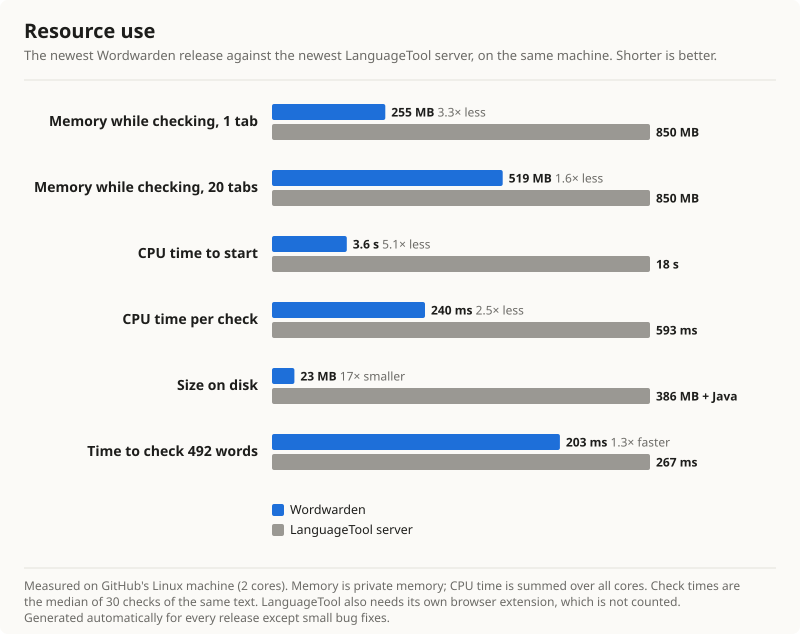

# Wordwarden

Wordwarden is a free, privacy-first browser extension for one-click English
spelling and grammar corrections. Text stays on the device, and all checks use
only assets packaged with the extension.

**[Get it for Firefox](https://addons.mozilla.org/en-GB/firefox/addon/wordwarden-spell-grammar/)** ·
[Chromium and LibreOffice downloads](https://github.com/Abhisek571/wordwarden/releases/latest)

## Features

- Spelling and grammar checks as you type, on your device. Nothing you write is sent anywhere.
- Click an underline to pick a fix. Text never changes without a click.
- Your own dictionary, per-site on/off, and US, UK, Canadian or Australian English.
- A typing test page with speed and accuracy.
- Works in Firefox and Chromium browsers (Chrome, Edge, Brave and others). Light on memory: all
  tabs share one checker.
- A LibreOffice add-on with the same spelling and grammar engine.

## Install

- **Firefox:** install it from
  [Firefox Add-ons](https://addons.mozilla.org/en-GB/firefox/addon/wordwarden-spell-grammar/). It updates itself.
- **Chromium browsers (Chrome, Edge, Brave and others):** Wordwarden is on its way to the Chrome Web
  Store. Until then, download the `chrome` zip from
  [Releases](https://github.com/Abhisek571/wordwarden/releases/latest), unzip it, open
  `chrome://extensions`, turn on Developer mode and choose **Load unpacked**. This copy does not
  update itself; download the new zip for each release.
- **LibreOffice:** download the `libreoffice` file for your system (`windows`, `macos` or
  `linux`) from [Releases](https://github.com/Abhisek571/wordwarden/releases/latest) and double-click it, or open **Tools > Extension Manager** and choose **Add**. Restart
  LibreOffice. Wordwarden then checks spelling and grammar in English documents; settings are in
  **Tools > Options > Languages and Locales > Wordwarden**. Apache OpenOffice may work but is not tested.

## Accuracy


Measured on public test sets that are not bundled with the extension, using held-out data that
was not used for tuning. The chart is redrawn automatically for each bigger release.

Wordwarden catches most everyday typos but still misses many grammar and fluency problems, and
typing slips that make another real word ("form" for "from"). Test sets, method and credits:
[docs/BENCHMARKS.md](docs/BENCHMARKS.md).

## Performance



The newest release against your own LanguageTool server, checking the same text on the same
machine. Wordwarden needs far less memory and start-up time, and nothing to install besides the
extension. All tabs share one checker, so a second or third tab adds little memory. It uses no CPU
while you are not typing, and once you leave a text box the browser may unload the checker to free
its memory. The chart is redrawn automatically for each bigger release. Method:
[docs/BENCHMARKS.md](docs/BENCHMARKS.md#resource-use).

## Reporting a problem

Open Wordwarden's settings, choose **Report issue**, then **Generate diagnostic log** and
**Copy log**. **Open GitHub Issue** opens a new issue; paste the log into it. The log holds
browser and extension details only, never your writing, and nothing is sent automatically.

## Development

Requires Node.js 22 or newer.

```sh
npm install
npm run dev            # Chromium
npm run dev:firefox
```

Checks (the same ones run on GitHub for every push):

```sh
npm run compile
npm test
npm run build
npm run build:firefox
npm run lint:firefox
npm run test:e2e
```

### Building the Firefox package from source

Works on Windows, macOS and Linux with [Node.js](https://nodejs.org/) 22 or newer and the npm
that comes with it. No other tools are needed.

```sh
npm ci
npm run zip:firefox
```

The package is written to `.output/wordwarden-<version>-firefox.zip`, and the unpacked files to
`.output/firefox-mv3/`.

`npm run zip` and `npm run zip:firefox` create store archives; pushing a version tag such as
`v1.1.0` builds them on GitHub and attaches them to a release. The browser tests need an
open-source Chromium build, because branded Chrome and Edge 137+ block command-line extension
loading.

See [privacy](docs/PRIVACY.md), [permissions](docs/PERMISSIONS.md) and
[third-party notices](THIRD_PARTY_NOTICES.md).

## License

Copyright (C) 2026 Wordwarden contributors. Licensed under the
[GNU General Public License v3.0](LICENSE).

For the licences of the open-source parts it includes, see [third-party notices](THIRD_PARTY_NOTICES.md).
