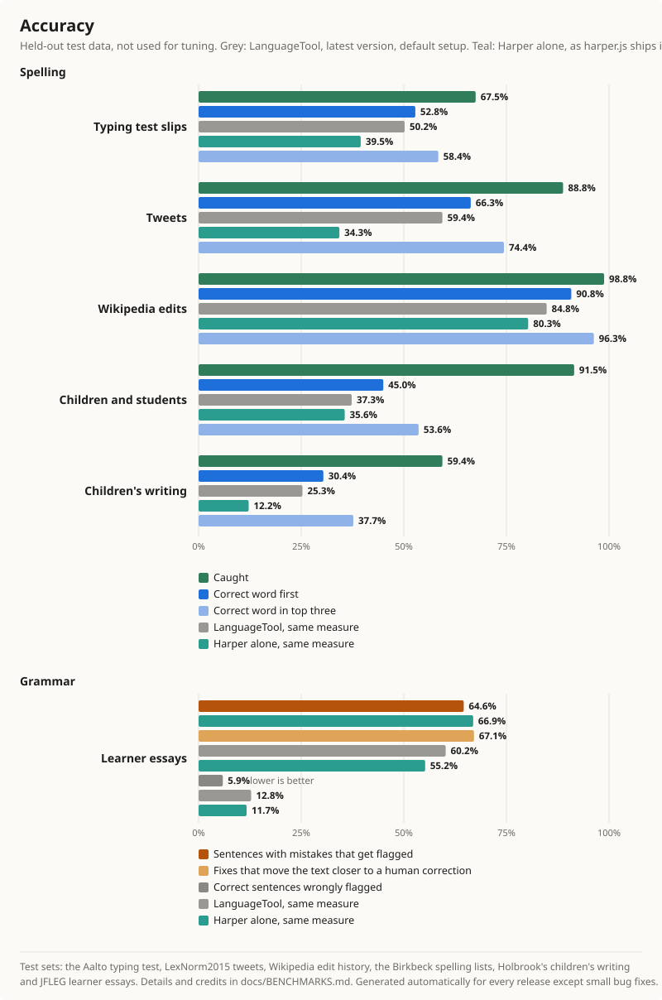

# Wordwarden

Wordwarden is a free, privacy-first browser extension for one-click English
spelling and grammar corrections. Text stays on the device, and all checks use
only assets packaged with the extension.

## Features

- Spelling and grammar checks as you type, on your device. Nothing you write is sent anywhere.
- Click an underline to pick a fix. Text never changes without a click.
- Your own dictionary, per-site on/off, and US, UK, Canadian or Australian English.
- A typing test page with speed and accuracy.
- Works in Firefox and Chromium browsers (Chrome, Edge, Brave and others).

## Install

Wordwarden is on its way to Firefox Add-ons and the Chrome Web Store. Until then, download the
latest zip from [Releases](../../releases) and load it yourself:

- **Chromium browsers:** unzip the `chrome` zip, open `chrome://extensions`, turn on
  Developer mode and choose **Load unpacked**.
- **Firefox:** open `about:debugging#/runtime/this-firefox`, choose **Load Temporary Add-on** and
  pick the `firefox` zip. Firefox removes it when it restarts.

## Accuracy



Measured on public test sets that are not bundled with the extension, using held-out data that
was not used for tuning. The chart is redrawn automatically for each bigger release.

| Grammar and speed | Result |
|---|---|
| [JFLEG](https://github.com/keisks/jfleg) learner essays | flags 67.4% of sentences that need edits; 58.1% of first fixes move the text closer to a human correction |
| JFLEG human-corrected text | 11.3% of sentences get any underline (an upper bound on false alarms) |
| Speed | 85 ms median to check 535 words on a desktop PC |

Wordwarden catches most everyday typos but still misses many grammar and fluency problems, and
typing slips that make another real word ("form" for "from"). Test sets, method and credits:
[docs/BENCHMARKS.md](docs/BENCHMARKS.md).

## Reporting a problem

Open Wordwarden's settings, choose **Report issue**, then **Generate diagnostic log** and
**Copy log**. **Open GitHub Issue** opens a new issue; paste the log into it. The log holds
browser and extension details only, never your writing, and nothing is sent automatically.

## Development

Requires Node.js 22 or newer.

```sh
npm install
npm run dev            # Chromium
npm run dev:firefox
```

Checks (the same ones run on GitHub for every push):

```sh
npm run compile
npm test
npm run build
npm run build:firefox
npm run lint:firefox
npm run test:e2e
```

`npm run zip` and `npm run zip:firefox` create store archives; pushing a version tag such as
`v1.1.0` builds them on GitHub and attaches them to a release. The browser tests need an
open-source Chromium build, because branded Chrome and Edge 137+ block command-line extension
loading.

See [privacy](docs/PRIVACY.md), [permissions](docs/PERMISSIONS.md) and
[third-party notices](THIRD_PARTY_NOTICES.md).
